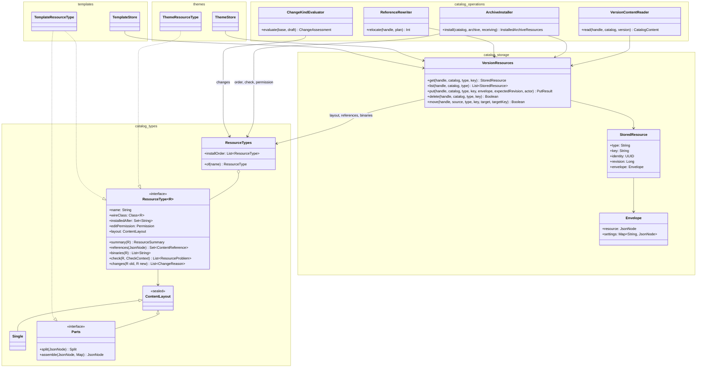

# ADR 0039: The catalog knows no content type

- **Status:** Proposed
- **Date:** 2026-10-28
- **Deciders:** Epistola team
- **Tags:** catalog, architecture, storage, import, export, relocation
- **Related:** [ADR 0038](0038-catalogs-in-2-0.md) (one storage for every version),
  [ADR 0037](0037-resource-identity-and-relocation.md) (identity and relocation)

## Context

Since ADR 0038 a catalog is a versioned, content-addressed store of typed documents. Every resource
of every version, draft or released, is one row (`release_resources`) naming one content
(`resource_contents`) in one shape, `{ "resource": <wire form>, <setting>: … }`. What a content
refers to is indexed (`resource_references`) and the bytes it needs are linked (`resource_binaries`).
None of that depends on the resource's type.

The operations on top of that storage still go type by type, because they were written when each
type had its own tables:

- **Import** unpacks each wire resource into a domain command (`ImportTheme` has eight fields) whose
  store packs it back into the same wire form. There are six such round trips, plus a `when` over the
  protocol classes in `CatalogResourceInstaller`.
- **Export** (`CatalogContentBuilder`) asks each domain's `Export*` query for its resources and maps
  them back to wire form. Meanwhile `ReleaseContentAssembler` already builds the same
  `CatalogContent` for a release generically, from rows and contents.
- **Relocation** has one rewrite per type (`JsonRewrite.StencilContent`, `ThemeStyles`,
  `AttributeContent`, `VariantModel`, …) over each domain's store. Every one of them rewrites
  references that `ResourceReferenceSites` already knows how to find.
- **Release** rebuilds the draft's content as wire form, then reads the code-list store to put each
  list's `source` setting back beside it. The draft's envelopes already hold it.
- **Checks** switch on the type in several places: `ChangeKindEvaluator`, `ReleaseStencilCheck`,
  `MarkCatalogReady`, `CatalogUpgradeAnalyzer`, `DependencyScanner`, `ResourceContentStore`
  (binaries), `ContentReferences` (a template's theme) and `RESOURCE_INSTALL_ORDER`.

As a result `catalog` depends on every content domain (39 entries in `CatalogBoundaryTest.ALLOWED`),
while every content domain depends on `catalog` for version addressing and storage (92 files). The
two form a cycle. Adding a content type, or changing how one is stored, means editing catalog's
import, export, relocation and release code.

## Decision

Catalog holds resources as `(type, key, envelope)` and never names a content domain. What is
specific to a type is said once, by the domain that owns it, in a **`ResourceType`** that catalog
collects. Catalog's operations are written once, against the generic storage, and ask the type only
through that interface.

Three layers, each depending only on the ones below it:



### 1. `catalog.types`: what a type is

The one interface a content domain implements for catalog. Its defaults cover a type with nothing
special, so a simple type implements only `name`, `wireClass`, `editPermission` and `summary`.

```kotlin
package app.epistola.suite.catalog.types

/**
 * One kind of catalog resource, as the contract names it, said by the domain that owns it. Catalog
 * stores, imports, exports, relocates and releases every type through this, and names no domain.
 */
interface ResourceType<R : CatalogResource> {
    /** The wire name: `theme`, `codeList`, … The key of `release_resources.resource_type`. */
    val name: String

    /** The contract's class for it, which import binds to and the checks read. */
    val wireClass: Class<R>

    /** Types whose resources must be in place before one of this is installed (an attribute binds a code list). */
    val installedAfter: Set<String> get() = emptySet()

    /** What changing one of these needs; import checks it, as each `Import*` command did. */
    val editPermission: Permission

    /** How its content is laid out in rows: one, or a parent and its parts (a template and its variants). */
    val layout: ContentLayout get() = ContentLayout.Single

    /** The columns its row carries for lists: name, description, and any summary the type keeps. */
    fun summary(resource: R): ResourceSummary

    /**
     * What a content refers to. The default walks the document shapes ([ResourceReferenceSites]);
     * a type adds the typed references it carries at its top level (a template's theme).
     */
    fun references(content: JsonNode): Set<ContentReference> = ResourceReferenceSites.references(content)

    /** The binaries its content needs, by hash: an image's bytes, a font's faces. */
    fun binaries(resource: R): List<String> = emptyList()

    /** What is wrong with it in [context] (the version it goes into, what that version resolves). */
    fun check(resource: R, context: CheckContext): List<ResourceProblem> = emptyList()

    /** What changing [old] into [new] means for a version number, beyond "it changed". */
    fun changes(old: R, new: R): List<ChangeReason> = emptyList()
}

/** How a type's content is stored: as one content, or as a parent and one row per part. */
sealed interface ContentLayout {
    data object Single : ContentLayout

    /**
     * A resource stored as a parent content and parts of its own, so that editing one part stores
     * only that part (a template: the template, and one row per variant with its model).
     */
    interface Parts : ContentLayout {
        fun split(resource: JsonNode): Split
        fun assemble(parent: JsonNode, parts: Map<String, JsonNode>): JsonNode
    }

    data class Split(val parent: JsonNode, val parts: Map<String, JsonNode>)
}

/** Every [ResourceType] the application has, by name, and the order an archive installs them in. */
@Component
class ResourceTypes(types: List<ResourceType<*>>) {
    fun of(name: String): ResourceType<*>

    /** Topological over [ResourceType.installedAfter]; replaces `RESOURCE_INSTALL_ORDER`. A cycle fails at startup. */
    val installOrder: List<ResourceType<*>>
}
```

### 2. `catalog.storage`: one reader and writer of a version's resources

`VersionResources` merges what `DraftResources`, `ResourceContentStore.store`, `VariantRows` and
the read half of `ReleaseContentAssembler` do today. It is the only place that writes
`release_resources`, `resource_contents`, `resource_references` and `resource_binaries` for a
resource. Every method works on the version its message targets (`versionAt`), as today. Writing
refuses a released version (`Handle.writable`).

```kotlin
package app.epistola.suite.catalog.storage

/** A content's one shape (ADR 0038): the released form, and the settings only this suite keeps beside it. */
data class Envelope(val resource: JsonNode, val settings: Map<String, JsonNode> = emptyMap())

/** One resource of a version, as its row and content hold it. */
data class StoredResource(val type: String, val key: String, val identity: UUID, val revision: Long, val envelope: Envelope)

@Component
class VersionResources(private val types: ResourceTypes, private val objectMapper: ObjectMapper) {
    fun get(handle: Handle, catalog: CatalogId, type: String, key: String): StoredResource?
    fun list(handle: Handle, catalog: CatalogId, type: String? = null): List<StoredResource>

    /**
     * Stores [envelope] as [type] [key] of the targeted draft. It is split by the type's layout,
     * indexed by its references and binaries, and checked against [expectedRevision] when given.
     */
    fun put(handle: Handle, catalog: CatalogId, type: String, key: String, envelope: Envelope, expectedRevision: Long? = null, actor: UUID?): PutResult

    fun delete(handle: Handle, catalog: CatalogId, type: String, key: String): Boolean
    fun move(handle: Handle, source: CatalogId, type: String, key: String, target: CatalogId, targetKey: String): Boolean
}

sealed interface PutResult {
    data class Inserted(val identity: UUID, val revision: Long) : PutResult
    data class Updated(val revision: Long, val updatedAt: OffsetDateTime) : PutResult
    data object Unchanged : PutResult
    data object Stale : PutResult
}
```

The kernel that domains already use stays where it is: version addressing (`CatalogSql`), release
targeting (`CatalogReleaseScoped`), the edit guard, dependency declarations and ready marks.

### 3. Catalog operations, written once

| Operation  | Becomes                                                                                                                                                                                                 | Replaces                                                                                                       |
| ---------- | ------------------------------------------------------------------------------------------------------------------------------------------------------------------------------------------------------- | -------------------------------------------------------------------------------------------------------------- |
| Export     | `VersionContentReader.read`: every row of the version, each envelope's `resource` (assembled by its layout), as stored, with name qualifiers dropped. The same for a draft and a release.               | `CatalogContentBuilder`'s per-type loading, the `Export*` queries, `ProtocolMapper`, `ReleaseContentAssembler` |
| Import     | `ArchiveInstaller`: for each type in `installOrder`, bind each detail to `wireClass` through the schema migrator, check `editPermission`, run `check`, then `VersionResources.put(Envelope(resource))`. | `CatalogResourceInstaller`, the six `Import*` commands, the stencil pre-parse                                  |
| Relocation | `ReferenceRewriter`: the contents that name a moved address (`resource_references`) are rewritten through `ResourceReferenceSites` and stored again; the moved rows go by `VersionResources.move`.      | The per-type `JsonRewrite` cases, the per-type store moves                                                     |
| Release    | Freezes the draft's rows (ADR 0038). Settings travel in the envelope, so nothing is rebuilt or looked up.                                                                                               | The code-list `source` lookup in `ReleaseCatalogDraftHandler`                                                  |
| Checks     | `ChangeKindEvaluator` pairs resources by `(type, key)` and asks `changes`. Release and install checks ask `check`. `DependencyScanner` and the upgrade analyser read `references`.                      | The `is TemplateResource ->` switches, `ReleaseStencilCheck`                                                   |
| Ready      | `ReadyMarks` over the version's rows, for any type that is marked.                                                                                                                                      | `MarkStencilReady`, `MarkTemplateReady` called from `MarkCatalogReady`                                         |

### What a domain keeps

A domain keeps what makes it a domain: its editing commands and their validation, its read models
(`current_themes` and friends), rendering, the editor, and the fields it edits (`ThemeFields`).
Its store maps those fields to the wire form, which the `Theme.fields()` and `ThemeStore.resource`
pair already does, and writes through `VersionResources.put`. Each domain adds one class:

```kotlin
package app.epistola.suite.themes

@Component
class ThemeResourceType : ResourceType<ThemeResource> {
    override val name = "theme"
    override val wireClass = ThemeResource::class.java
    override val installedAfter = setOf("font", "image")
    override val editPermission = Permission.THEME_EDIT
    override fun summary(resource: ThemeResource) = ResourceSummary(resource.name, resource.description)
}
```

Templates bring the only non-default layout (`Parts`, from `TemplateContents`), a top-level
reference (the theme), checks (variant attributes resolve) and change rules (the data contract). Fonts
and images bring `binaries`. Code lists bring the `source` setting, which stays in their envelope.

### The test of it

`CatalogBoundaryTest.ALLOWED` ends empty. Adding a type means writing its domain and its
`ResourceType`, and touching nothing in `catalog`.

## Consequences

- The cycle goes. Catalog depends on `ResourceType`, which it owns. The domains depend on catalog
  as they already do.
- Much of the per-type code goes: the six `Import*` commands (about 670 lines), the per-type half of
  `CatalogContentBuilder` (342 lines) and the per-type rewrites in relocation (about 1,500 lines in
  `relocation/`, not all of it per type). One path per operation replaces six.
- Draft and release export share one reader, so they cannot drift. Today they can, which is why
  `catalog/AGENTS.md` warns that a field must be threaded through `ImportTemplates` and
  `CatalogContentBuilder` by hand.
- Import no longer runs through a domain's create/update commands, so the validation in those
  commands' `init` blocks does not run on import. What import must enforce moves into `check`, where
  it applies to every way a resource arrives. Today that split is already uneven: imported names are
  allowed up to the column ceiling, not the interactive limit.
- Typed hooks (`R : CatalogResource`) mean a bind from JSON per call. Import binds anyway. Change
  evaluation over a whole version binds every resource twice, as it does today.

## What the spike showed (2026-10-28)

A spike on branch `refactor/resource-types-spike` built `ResourceType`, `ResourceTypes`, one type
per domain, a generic `VersionResourceReader`, and import for themes and templates through their
type. It changes the decision above in two places.

- **Import needs a hook the type owns: `receive`.** Import is not a round trip of the wire form.
  `ImportTemplatesHandler` validates (the model is publishable, the data-contract schema and its
  property names, exactly one default variant) and rewrites (`TemplateDocumentPreparation.prepare`
  per variant, a title-less variant titled by its key, the template's model for a variant without
  one, a ready mark). `ThemeStore` rounds `spacingUnit` to two decimals. A generic
  `put(Envelope(resource))` would skip all of that, and `check` would have to repeat each domain's
  import rules. So each type has
  `fun receive(catalog: CatalogId, resource: R, arrival: Arrival): InstallStatus`, where `Arrival`
  carries the release version, the archive's binaries and an alias resolver. In the spike it
  dispatches the domain's own import command, moved into the domain unchanged (`ImportTheme` into
  `themes.commands`, `ImportTemplates` into `templates.commands`), so authorisation, transactions
  and validation stay as they are. `editPermission` and the import half of `check` are not needed.
  This is the one per-operation hook, because it is the one operation whose per-type logic is
  domain behaviour and not plumbing. Export, release and relocation stay generic.
- **Export reads what is stored, and relativises nothing.** The spike's first generic export
  relativised every resource's own-catalog references. It disagreed with the per-type export for
  the system catalog's theme, whose own font reference has always travelled as stored
  (`"catalogKey": "system"`). Stencils and templates store their references relative already
  (ADR 0038). The rule that agrees with both paths is the one `ReleaseContentAssembler` applies:
  the envelope's `resource`, name qualifiers dropped. So a draft exports by the same rule as its
  release, and `DraftReleaseSameContentTest` now holds that a draft's export equals the export of the
  release cut from it.

Evidence: the generic export ran beside the per-type export inside `CatalogContentBuilder.build()`
and failed on any difference, across the catalog, template, theme, validation and exchange
integration tests. `CatalogBoundaryTest.ALLOWED` went from 39 to 33 entries.

## Where it landed (2026-10-28)

On `refactor/resource-types-spike`, `CatalogBoundaryTest.ALLOWED` is empty: `catalog` depends on no
content domain. What a type says, and where:

| Hook or SPI                                                  | Owner                                       | Used by                                             |
| ------------------------------------------------------------ | ------------------------------------------- | --------------------------------------------------- |
| `ResourceType.name`, `wireClass`, `installedAfter`, `layout` | each domain                                 | the generic reader, export, install order           |
| `ResourceType.receive`                                       | each domain                                 | import, upgrade, merge (`CatalogResourceInstaller`) |
| `ResourceType.markReady`                                     | templates, stencils                         | `MarkCatalogReady`                                  |
| `ResourceType.changes`                                       | templates, stencils, attributes, code lists | `ChangeKindEvaluator`                               |
| `ResourceType.references`                                    | templates (theme, variant attributes)       | the reference index (`ResourceContentStore`)        |
| `ResourceRelocator` (move, rewrite, follow a move)           | each domain                                 | `MoveCatalogResourcesHandler`                       |
| `ReleaseCheck`                                               | stencils                                    | `ReleaseCatalogDraft`                               |
| `CatalogAttributeValues`                                     | attributes                                  | `UpdateCatalogMetadata`                             |

Three decisions the work made:

- **Relocation is an SPI of its own, not part of `ResourceType`.** A relocator writes through its
  domain's store, and the content store reads the types to index references, so putting it on the
  type would make the beans depend on each other in a circle. It is also an alpha feature.
- **Variant attributes are references.** A template's variants name the attributes they select by;
  they are indexed in `resource_references` like every other reference (`TemplateResourceType.references`),
  and `V20261101001800` indexes those stored before. The upgrade analyser asks the index who uses an
  attribute, as it already did for code lists. `ReferenceWalkerGoldenVectorsTest` has the new case,
  `VariantAttributeReferencesMigrationTest` fails without the migration, and the new attribute case of
  `UpgradeCatalogTest` fails without the index.
- **Read-model helpers live with the read model.** `currentTemplateViewJoin` joins two views the
  catalog's migrations define, so it moved from `templates` to `catalog`; `validateAttributes` reads
  only attributes, so it moved from `templates` to `attributes`.

What is not generic yet, and is not a class dependency, so the boundary test cannot see it: SQL that
names a type's view or members. The relocation planner builds its rewrites per type from the views;
the upgrade analyser's theme, stencil and font checks scan JSON per type; the resource graph reads
each type's view for per-variant evidence; the catalog list's activity query names each view. Each
can move to the reference index as it is next touched, the planner first (step 6). The unified
writer (`VersionResources.put`) is not built: domain stores still write through `DraftResources`.

## Open questions

1. **`UpdateCatalogMetadataHandler`** validates the catalog's presentation images (asset media
   category) and attribute names. Are these `check`s of the image and attribute types, or catalog
   settings that list resources through `VersionResources`?
2. **Typed or JSON hooks.** `references` stays on JSON because the walker works on JSON. Should
   `check` and `changes` take JSON too, so that a type without a contract class is possible?
3. **The domain's read models.** `current_themes` and the other per-type views stay with their
   domain. Lists across types (the catalog overview's counts, `ListCatalogsForManagement`) read
   `catalog_version_resources` instead of joining a domain's view.
4. **The stencil pre-parse** in `CatalogArchiveResources` was there for a stencil version conflict
   (FAIL or RENUMBER). Stencil versions are gone, and only the comment remains. Confirm, then drop it
   with the rest of the per-type import.
5. **Stored content carries no wire version.** Decided in [ADR 0040](0040-storage-and-contracts.md):
   record it, migrate once at upgrade, keep the published form. The reasoning, kept for context:
   storage keeps each resource in the contract's wire
   form (ADR 0038), deliberately: a release must keep the form it was published and fingerprinted in
   (a received one byte for byte), and one format means no translation between storage and export
   that can drift. Suite-only data goes beside it in the envelope. But `resource_contents` does not
   record which wire version a content is in. It is implicitly the current one, and export stamps
   `CATALOG_SCHEMA_VERSION` on it. Archives are upgraded on import (`CatalogSchemaMigrator`); stored
   content is not. Before the next wire version, decide:
   - **migrate stored content forward** with a code migration (ADR 0035). Simple, but a release's
     stored bytes then change, so its recorded fingerprint must remain the one it was published
     with, never recomputed; or
   - **record the wire version with each content and upgrade on read**, through the migrator archives
     use. A release stays byte-identical, at the cost of a migration on every read of old content.

   Either way, the stability contract holds: stored content is never broken, only moved forward.

   Upgrading on every read would put a migration in front of every render. It need not: content is
   addressed by its hash and never changes, so its upgrade to a given wire version is always the
   same and can be made once. The likely answer combines both: keep each content as published
   (immutable, for its fingerprint and a byte-identical re-export), and migrate it once, at upgrade,
   into a current-version copy that rendering and editing read. The copy is one more row of
   `resource_contents`. Whether a re-export of a received release must match its published
   fingerprint, or the contract defines that fingerprint independently of the wire version, decides
   whether the published form must be kept at all.

## Order

Each step leaves the build green and shortens `ALLOWED`:

1. `ResourceType`, `ResourceTypes`, one implementation per domain with only `name`, `wireClass`,
   `installedAfter`, `editPermission` and `summary`. `RESOURCE_INSTALL_ORDER` is derived.
2. `VersionResources` over the existing `DraftResources` and `ResourceContentStore`. Domain stores
   move to it one at a time.
3. Export: one `VersionContentReader` for drafts and releases.
4. Import: `ArchiveInstaller`; the `Import*` commands go, themes and fonts first, templates last.
5. Release: freeze rows, drop the settings lookup.
6. Relocation: `ReferenceRewriter`.
7. Checks and change kind through the type; `ReadyMarks` generic.
